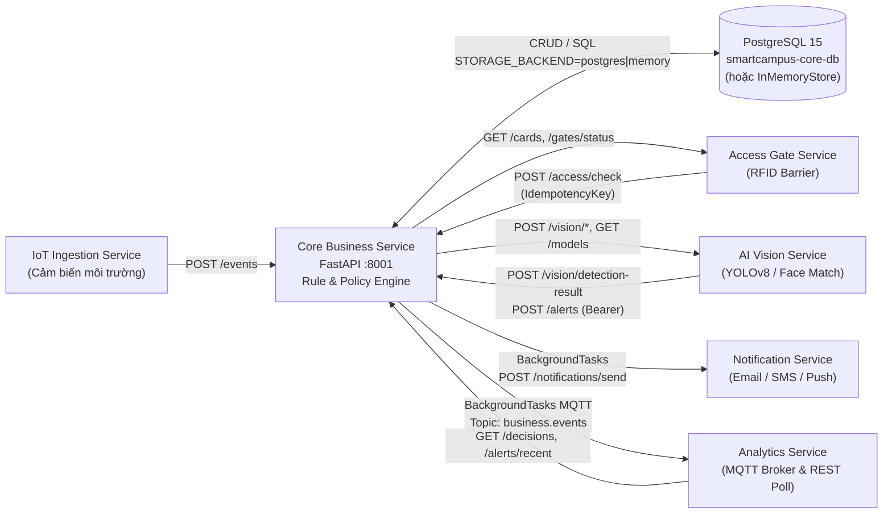

# Architecture One-Pager — Core Business Service

## 1. Vai trò trong Smart Campus Operations Platform
**Core Business Service** (`core-business`) là dịch vụ trung tâm xử lý nghiệp vụ của hệ thống Smart Campus. Dịch vụ tiếp nhận dữ liệu từ các phân hệ thu thập (**IoT Ingestion**, **AI Vision**, **Access Gate**), đánh giá tập luật nghiệp vụ và chính sách bảo mật (**Rule & Policy Engine**), lưu vết quyết định/cảnh báo, đồng thời phân phối sự kiện tới **Analytics** (MQTT) và kích hoạt thông báo khẩn cấp qua **Notification Service** (REST).

---

## 2. Sơ đồ Kiến trúc & Kết nối Liên Dịch Vụ

---

## 3. Thành phần Nội bộ & Thiết kế Dual Storage

1. **API & Validation Layer (`src/core_app/main.py`)**:
   - Xây dựng trên **FastAPI + Pydantic v2**, chuẩn hóa lỗi **RFC 9457 ProblemDetails** (`application/problem+json`).
   - Hỗ trợ `Bearer Token` (`AUTH_TOKEN` cấu hình qua biến môi trường) bảo vệ đầu vào tạo cảnh báo.
   - Hỗ trợ tương thích payload từ nhiều nhóm đối tác (lồng OpenAPI hoặc phẳng ở `POST /events`).
2. **Rule & Policy Engine (`_evaluate_access_policy` & `ingest_event` / `receive_ai_vision_detection`)**:
   - **Kiểm soát ra vào (`POL-001`)**: Kiểm tra định dạng thẻ `RFID-YYYY-NNN`, mã cổng `GATE-XX`, danh sách cổng hợp lệ (`GATE-01`, `GATE-02`), danh sách đen, khung giờ (`06:00–22:00`), chống quẹt trùng (`409 Conflict` via `idempotencyKey`) và giới hạn tần suất (rate-limit 60s). Mọi quyết định `DENY` tự động sinh cảnh báo `UNAUTHORIZED_ACCESS` mức `HIGH`.
   - **Giám sát cảm biến IoT**: Tự động phát hiện quá ngưỡng nhiệt độ (`> 40°C` cảnh báo `HIGH`, `> 50°C` cảnh báo `CRITICAL`).
   - **Giám sát AI Vision**: Đánh giá `risk_level` hoặc vùng hạn chế `restricted_area` để sinh `UNKNOWN_PERSON` / `SUSPICIOUS_OBJECT`.
3. **Dual Storage Abstraction (`src/core_app/storage.py`)**:
   - `BaseStore` chuẩn hóa 16 phương thức nghiệp vụ cho cả hai backend:
     - `PostgresStore`: Kết nối `psycopg3` tự động khởi tạo DDL 5 bảng (`alerts`, `policies`, `decisions`, `events`, `idempotency_keys`) kèm dữ liệu seed ban đầu, đảm bảo bền vững qua khởi động lại container.
     - `InMemoryStore`: Thread-safe dictionary/list (`threading.RLock`), tiện chạy unit test tức thì hoặc demo khi không bật DB.
   - Chuyển đổi trực tiếp bằng biến `STORAGE_BACKEND=postgres|memory` hoặc 2 dòng comment sẵn trong `create_store()` / `.env`.
4. **Non-Blocking Integration & Fan-out**:
   - `BackgroundTasks` tách việc gửi MQTT và Notification ra khỏi critical path của request HTTP, giữ thời gian phản hồi `POST /access/check` dưới ngưỡng **200 ms**.
   - `GET /integrations/status` dùng `asyncio.gather` + thread pool (`anyio.to_thread.run_sync`) quét đồng thời 5 dịch vụ đối tác với timeout 1.5s/dịch vụ.

---

## 4. Thuộc tính Chất lượng (Non-Functional Requirements)

| Thuộc tính | Cơ chế đảm bảo | Kết quả mục tiêu |
|---|---|---|
| **Latency (SLA)** | Rule evaluation O(1)/indexed query + async `BackgroundTasks` | `POST /access/check` `< 200 ms` |
| **Reliability & Idempotency** | Persist `idempotencyKey` trong Postgres (`PRIMARY KEY`) / Memory set | Trùng giao dịch trả `409 Conflict` |
| **Portability (LAN & Local)** | `.env.example` + `docker-compose.mock.yml` + cấu hình động `/integrations/config` | 1 lệnh chạy ngay với 5 mock containers hoặc LAN IPs |
| **Security & Hardening** | Container chạy non-root `appuser`, không hardcode secret trong mã nguồn hay HTML | Đạt Spectral OpenAPI lint & container healthcheck |
